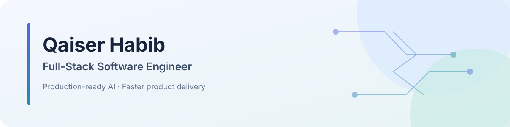

<picture>
  <source media="(max-width: 600px) and (prefers-color-scheme: dark)" srcset="./assets/banner-mobile-dark.svg">
  <source media="(max-width: 600px)" srcset="./assets/banner-mobile.svg">
  <source media="(prefers-color-scheme: dark)" srcset="./assets/banner-dark.svg">
  
</picture>

# Full-Stack Software Engineer

**Production-ready applications · AI-assisted engineering · Faster delivery**

I build web products and AI-powered workflows across frontend, backend, APIs, and real-time systems. I use AI-assisted development to move faster, then analyze, review, debug, optimize, and validate the work for quality, security, performance, and maintainability. I also integrate LLMs, agents, and retrieval workflows into practical applications.

**Open to remote roles and contract projects.** 
Pakistan · UTC+5

[Email](mailto:qaiserhabib6@gmail.com) · [LinkedIn](https://www.linkedin.com/in/qaisarhabib/) · [GitHub](https://github.com/qaisarhabib)

## Selected experience

- **Focus IT Services · Frontend Developer · 2025–present:** Build production React and Next.js features, integrate LLM services with application workflows, and improve performance with code splitting, lazy loading, and caching.
- **Single Solution · Full-Stack Developer · 2023–2025:** Built and optimized full-stack applications, improved architecture and responsiveness, and contributed to AI-powered features and LLM workflows.
- **SoftRobo · Frontend Developer Intern · 2022–2023:** Built responsive web interfaces with attention to accessibility and usability.

## Project highlights

- **AI customer support platform:** Multi-tenant chat with tool-based order and return handling, agent handoff, a live dashboard, and an embeddable branded widget.
- **HR management system:** Employee, attendance, leave, payroll, access control, and reporting workflows.
- **UndrRight legal assistant:** AI-powered legal workflows with responsive interfaces and centralized application state.

## Technologies

| Area | Tools |
| --- | --- |
| Languages | JavaScript, TypeScript, Python, SQL, C/C++ |
| Web | React, Next.js, Tailwind CSS |
| Backend & APIs | Node.js, Express.js, NestJS, REST, GraphQL, Socket.io, SSE |
| Data & state | MongoDB, PostgreSQL, Prisma, React Query, Redux Toolkit, Zustand |
| AI | LLM APIs, RAG, agents, tool calling, Ollama |
| Cloud & workflow | Docker, Kubernetes, AWS, Linux, CI/CD, Git, GitHub |

## Education

**B.S. in Software Engineering** · Minhaj University Lahore · 2017–2021

## Get in touch

[qaiserhabib6@gmail.com](mailto:qaiserhabib6@gmail.com) · [LinkedIn](https://www.linkedin.com/in/qaisarhabib/)
